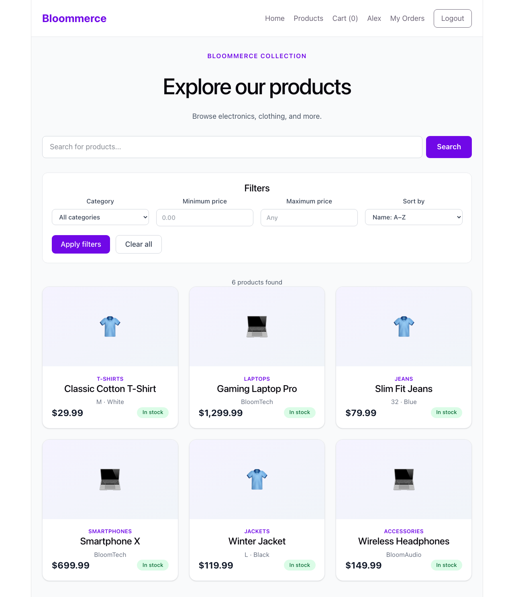
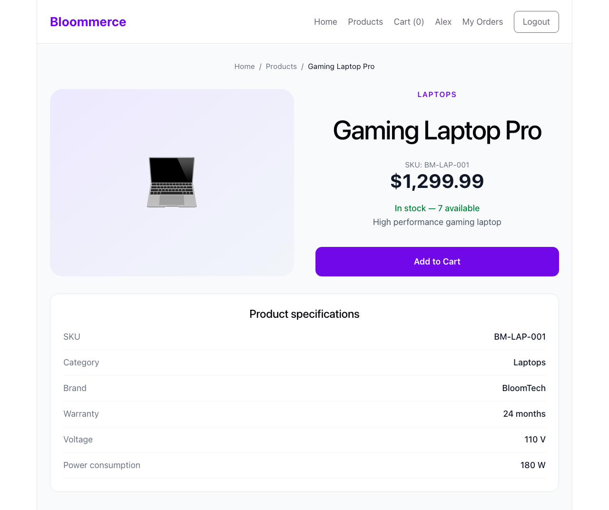
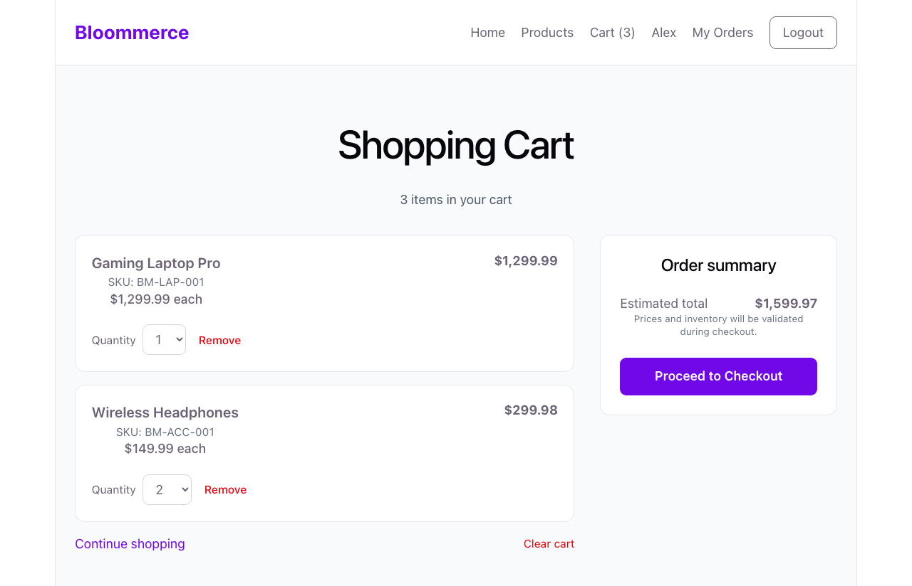
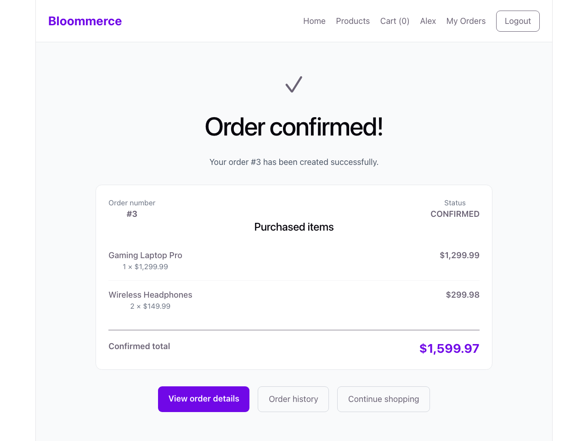
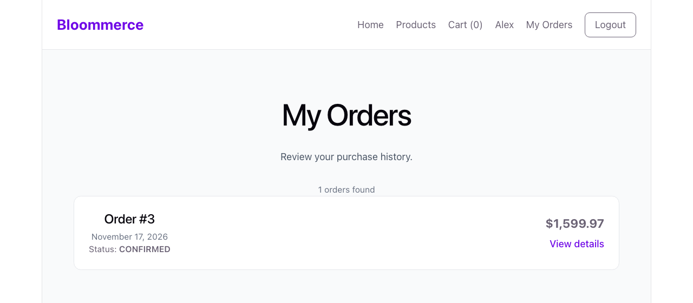

# Bloommerce 🌸

**Full-stack e-commerce application built with Java 21, Spring Boot 4, React 19, TypeScript, and PostgreSQL 17.**

Bloommerce demonstrates the design and implementation of a modern e-commerce platform, combining secure REST APIs, inventory management, transactional order processing, and a responsive frontend.

The project emphasizes clean architecture, data consistency, automated testing, and collaborative software development practices.

## Features

### Product Management

- Electronics and clothing products with category-specific attributes.
- Product creation, retrieval, updating, and soft deletion.
- Product search, filtering, pagination, and sorting.
- Inventory tracking and stock availability validation.
- Role-based restrictions for administrative operations.

### Authentication and Security

- Customer registration and login.
- JWT-based authentication using Spring Security.
- Password hashing and secure credential validation.
- CUSTOMER and ADMIN authorization roles.
- Protected frontend routes and REST endpoints.
- Order access restricted to the authenticated customer.

### Shopping Cart and Checkout

- Shopping cart managed using React Context API.
- Cart persistence using browser localStorage.
- Product quantity management and removal.
- Estimated order totals.
- Stock validation before checkout.
- Transactional order creation and inventory deduction.
- Concurrency protection against inventory overselling.
- Order confirmation and paginated order history.
- Historical purchase prices preserved in order details.

## Technology Stack

| Layer | Technologies |
|---|---|
| Backend | Java 21, Spring Boot 4.1.2, Spring MVC |
| Security | Spring Security, JWT |
| Persistence | Spring Data JPA, Hibernate, PostgreSQL 17 |
| Database migrations | Flyway |
| Frontend | React 19, TypeScript, Vite, Tailwind CSS v4 |
| Frontend state | React Context API, React Router |
| Backend testing | JUnit 5, Mockito, MockMvc, Testcontainers |
| Frontend testing | Vitest, React Testing Library |
| Coverage | JaCoCo |
| CI | GitHub Actions |
| Infrastructure | Docker Compose, Maven, npm |

## Architecture

Bloommerce follows a layered backend architecture with a component-based React frontend.

**Backend request flow:**

```text
React Frontend
      |
      | HTTP / JSON
      v
Spring Security
      |
      v
REST Controllers
      |
      v
Business Services
      |
      v
Spring Data JPA Repositories
      |
      v
PostgreSQL
```

Spring Boot is responsible for authentication, authorization, business validation, inventory consistency, and transactional persistence.

The frontend handles user interactions, routing, authentication state, and shopping cart state.

Final prices and stock availability are validated by the backend during checkout.

### Repository Structure

```text
bloommerce/
├── backend/
│   ├── src/main/
│   │   ├── java/com/bloommerce/backend/
│   │   └── resources/
│   │       └── db/migration/
│   ├── src/test/
│   └── pom.xml
├── frontend/
│   ├── src/
│   │   ├── api/
│   │   ├── components/
│   │   ├── context/
│   │   ├── hooks/
│   │   ├── pages/
│   │   └── types/
│   └── package.json
├── docs/
├── .github/workflows/
├── compose.yaml
├── .env.example
└── README.md
```

## Getting Started

### Prerequisites

Install the following tools:

- Java 21
- Maven 3.9+ or the included Maven Wrapper
- Node.js 24 and npm
- Docker Desktop or Docker Engine with Compose
- Git

### 1. Clone the Repository

```bash
git clone https://github.com/juancarlosp94/bloommerce.git
cd bloommerce
```

### 2. Configure Environment Variables

Copy the example environment file:

```bash
cp .env.example .env
```

Generate a Base64-encoded JWT signing key:

```bash
openssl rand -base64 32
```

Update `.env` with your local credentials and generated signing key:

```dotenv
POSTGRES_DB=bloommerce
POSTGRES_USER=bloommerce
POSTGRES_PASSWORD=replace_with_local_password

JWT_SECRET=replace_with_generated_base64_secret

VITE_API_BASE_URL=http://localhost:8080/api
```

Use a different, secure secret for each environment. Do not commit `.env` or real credentials.

### 3. Start PostgreSQL

From the repository root:

```bash
docker compose up -d
docker compose ps
```

Docker Compose starts PostgreSQL 17 on port `5432`.

The database uses a persistent Docker volume, so data is retained when the container stops.

**Note:** Port `5432` must be available. If another PostgreSQL instance already uses it, adjust the port mapping and backend connection URL accordingly.

### 4. Start Spring Boot

Load the environment variables on macOS or Linux:

```bash
set -a
source .env
set +a
```

Start the backend:

```bash
cd backend
./mvnw spring-boot:run -Dspring-boot.run.profiles=dev
```

The backend runs at:

http://localhost:8080

Flyway automatically applies pending database migrations during application startup.

Hibernate validates the resulting schema.


### 5. Start React

Open another terminal from the repository root:

```bash
cd frontend
cp .env.example .env.local
npm ci
npm run dev
```

The frontend development server runs at:

http://localhost:5173

The frontend uses `VITE_API_BASE_URL` from `frontend/.env.local`
to communicate with the Spring Boot REST API.

The default API URL is:

`http://localhost:8080/api`


## REST API

Bloommerce exposes REST endpoints for authentication, product management, and order processing.

### Authentication

| Method | Endpoint | Access |
|---|---|---|
| POST | `/api/auth/register` | Public |
| POST | `/api/auth/login` | Public |
| GET | `/api/auth/me` | Authenticated |

### Products

| Method | Endpoint | Access |
|---|---|---|
| GET | `/api/products` | Public |
| GET | `/api/products/{id}` | Public |
| POST | `/api/products` | ADMIN |
| PUT | `/api/products/{id}` | ADMIN |
| DELETE | `/api/products/{id}` | ADMIN |

Product listings support filtering by name, category, and price range, along with pagination and sorting.

### Orders

| Method | Endpoint | Access |
|---|---|---|
| POST | `/api/orders` | Authenticated |
| GET | `/api/orders` | Authenticated |
| GET | `/api/orders/{id}` | Order owner |

### Checkout Example

```json
{
  "items": [
    {
      "productId": 1,
      "quantity": 2
    }
  ]
}
```

The checkout request contains only product IDs and quantities. The backend obtains current prices, validates availability, calculates totals, and performs the inventory update transactionally.

## Documentation

Bloommerce includes technical documentation covering its architecture, database design, security, API, testing strategy, and engineering decisions.

### Architecture

- [System Architecture](docs/architecture/ARCHITECTURE.md)
- [Domain Model](docs/architecture/domain-model.md)
- [Entity Relationship Diagram (ERD)](docs/architecture/erd.md)

### Architecture Decision Records (ADRs)

- [ADR-001 — Product Inventory Management](docs/decisions/ADR-001-product-inventory.md)
- [ADR-002 — Product Soft Deletion](docs/decisions/ADR-002-product-soft-deletion.md)
- [ADR-003 — Inventory Concurrency and Reservation Strategy](docs/decisions/ADR-003-inventory-concurrency.md)

### API and Security

- [REST API Reference](docs/api/README.md)
- [Authentication and Authorization](docs/authentication.md)

### Quality Assurance

- [Testing Strategy and Coverage](docs/TESTING.md)

### Project Assessment

- [Technical Questions and Two-Day Development Plan](docs/technical-questions.md)


### Swagger / OpenAPI

Interactive API documentation:

http://localhost:8080/swagger-ui/index.html

OpenAPI specification:

http://localhost:8080/v3/api-docs

Use the Swagger **Authorize** option with a valid JWT when testing protected endpoints.

## Automated Testing

Bloommerce includes unit, integration, controller, and frontend component tests.

### Backend

From `backend/`:

```bash
./mvnw clean verify
```

The backend test suite uses PostgreSQL 17 through Testcontainers for database integration tests.

JaCoCo generates coverage reports and enforces a minimum of **80% line coverage**.

**Recorded backend line coverage: 93.49%.**

To view the report on macOS:

```bash
open target/site/jacoco/index.html
```

### Frontend

From `frontend/`:

```bash
npm ci
npm run test
npm run lint
npm run build
```

These commands verify component behavior, code quality, TypeScript compilation, and production bundling.

### Continuous Integration

GitHub Actions runs automated verification for pull requests targeting `main` and pushes to `main`.

The pipeline runs:

- Backend tests and JaCoCo coverage verification.
- PostgreSQL integration tests using Testcontainers.
- Frontend automated tests.
- ESLint verification.
- Frontend production build.

A failed verification step causes the corresponding CI job to fail.

For more information, see [Testing Strategy](docs/TESTING.md).

## Running the Application

The customer workflow is:

1. Register a customer account.
2. Log in using email and password.
3. Browse and filter the product catalog.
4. View product details.
5. Add products to the shopping cart.
6. Adjust quantities and review the estimated total.
7. Complete checkout.
8. View the confirmed order.
9. Review order history and purchase details.
10. Log out.

For administrative testing, an ADMIN account is required to create, update, or deactivate products.

## Application Demo

The following screenshots demonstrate Bloommerce's end-to-end
customer shopping experience.

### Product Catalog

Browse electronics and clothing products with search,
filtering, and pagination.



### Product Details

View product descriptions, pricing, and availability.



### Shopping Cart

Manage selected products, quantities, and estimated totals.



### Order Confirmation

Complete checkout and review the confirmed purchase.



### Order History

View previous purchases and order details.



## Development Workflow

Bloommerce follows GitHub Flow.

Each change is tracked through:

**Issue → Branch → Implementation → Testing → Pull Request → Merge**

Branches follow Conventional Commits-oriented naming conventions, including:

- `feat/` — New functionality
- `fix/` — Bug fixes
- `test/` — Testing
- `docs/` — Documentation
- `refactor/` — Refactoring
- `chore/` — Maintenance

Commits use descriptions such as:

```text
feat(order): implement transactional checkout
test(order): verify concurrent checkout
ci: enforce backend coverage checks
docs: update application documentation
```

## Known Limitations and Future Improvements

- Payment processing is not integrated.
- Browser-based E2E automation is not yet implemented; the full customer workflow has been manually verified.
- The shopping cart is stored in browser localStorage rather than persisted server-side.
- Frontend authentication state is kept in memory, so refreshing the application requires authentication again.
- Product seed data is not automatically included with a new local database.
- Additional production deployment configuration and monitoring would be needed before public deployment.

## License

No license is specified. All rights are reserved unless a license is added to the repository.