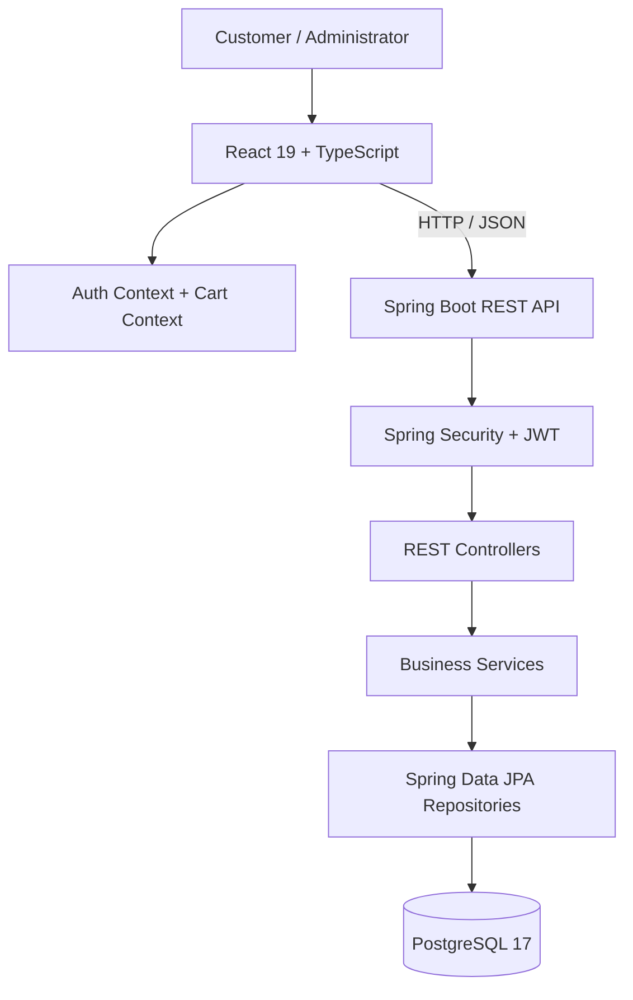
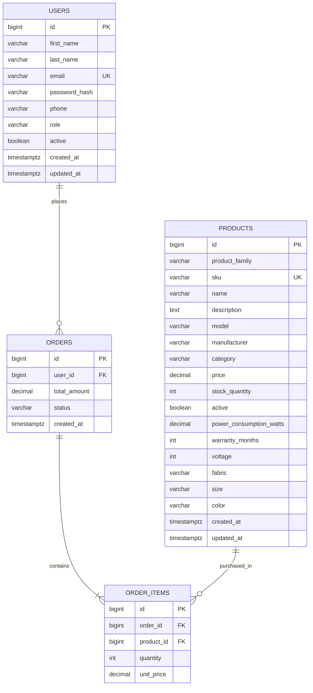
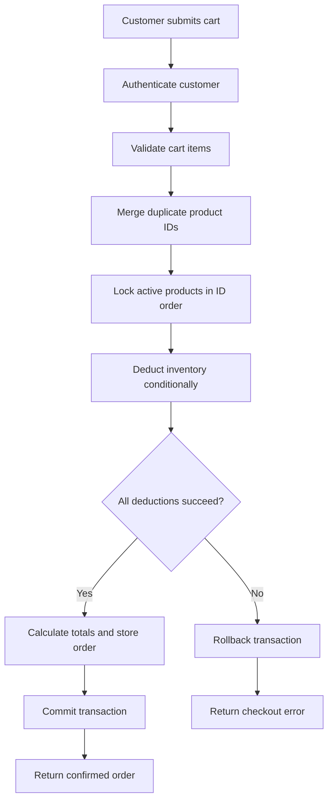

# Bloommerce — System Architecture

## 1. Architecture Overview

Bloommerce is a full-stack e-commerce application composed of a React frontend, a Spring Boot REST API, and a PostgreSQL database.

The application follows a layered backend architecture and a component-based frontend architecture.

Its primary responsibilities are product management, customer authentication, shopping cart management, transactional checkout, and order history.

### System Architecture Diagram

## 2. Backend Architecture

The backend is implemented with Java 21 and Spring Boot 4.1.2.

It follows the Controller → Service → Repository pattern.

### Controllers

Controllers expose REST endpoints, process requests, apply request validation, and return HTTP responses.

The main controllers are:

- `AuthController`: customer registration, login, and authenticated profile retrieval.
- `ProductController`: product listing, details, creation, updates, and soft deletion.
- `OrderController`: checkout, order history, and order details.

### Services

Services implement business rules and coordinate persistence.

- `AuthService`: account registration and related validation.
- `AuthLoginService`: authentication and token issuance.
- `ProductService`: product management, validation, and filtering.
- `OrderService`: order processing, inventory deduction, totals, and customer order access.

### Repositories

Spring Data JPA repositories abstract database persistence and queries.

Principal repositories:

- `UserRepository`
- `ProductRepository`
- `OrderRepository`

Business logic belongs in services rather than repositories or controllers.

## 3. Database Design

Bloommerce uses PostgreSQL 17 with Hibernate ORM and Flyway migrations.

The database contains four main tables:

- `users`
- `products`
- `orders`
- `order_items`

### Entity Relationship Diagram

The following diagram represents the relationships defined by the current JPA entities.

### Relationships

A user can place multiple orders.

Each order belongs to one user and contains one or more order items.

Each order item references a product and stores the price at the time of purchase.

The combination of `order_id` and `product_id` must be unique within `order_items`.

### Product Inheritance

Bloommerce uses JPA `SINGLE_TABLE` inheritance.

The abstract `Product` entity has two implementations:

- `ElectronicsProduct`
- `ClothingProduct`

Both types are stored in the `products` table and distinguished by the `product_family` column.

Electronics products support attributes such as voltage, warranty, and power consumption.

Clothing products support attributes such as fabric, size, and color.

This design enables shared product queries without joining separate subtype tables.

### Database Migrations

Flyway manages database schema changes through versioned SQL migration scripts.

Spring Boot applies pending migrations on startup, and Hibernate validates entity mappings against the database schema.

### Database Integrity and Constraints

Bloommerce enforces data integrity at both the application and database levels.

Application services validate business operations, while PostgreSQL provides additional protection through relational constraints.

**Database constraints include:**

- Unique email addresses and product SKUs.
- Foreign keys connecting orders to users and order items to orders and products.
- Nonnegative product prices and inventory quantities.
- Positive purchased quantities.
- Nonnegative order totals and purchase-time unit prices.
- Restricted user roles, product families, and order statuses.
- A unique combination of `order_id` and `product_id` within order items.

These constraints help prevent invalid data from being persisted, even if application-level validation is bypassed.

### Database Indexing

Flyway creates indexes for frequently accessed fields:

| Index | Column | Purpose |
|---|---|---|
| `idx_products_name` | `products.name` | Product name searches and sorting |
| `idx_products_category` | `products.category` | Category filtering |
| `idx_products_price` | `products.price` | Price filtering |
| `idx_orders_user_id` | `orders.user_id` | Customer order history |
| `idx_order_items_product_id` | `order_items.product_id` | Product-to-order-item lookups |

PostgreSQL also creates indexes to enforce primary key and unique constraints.

Index effectiveness depends on the query pattern and execution plan. These indexes should be evaluated as the application and dataset grow.

### Transactional Consistency

Checkout runs inside a Spring-managed database transaction.

The application uses product locking and conditional stock updates to prevent overselling.

If checkout fails, the transaction rolls back, preventing partially committed inventory deductions or orders.

PostgreSQL additionally enforces `stock_quantity >= 0` as a final integrity constraint.

### Schema Management

Flyway V1 defines the initial database schema.

Subsequent schema changes should use new versioned migrations rather than modifying previously applied migrations.

Hibernate validates the entity mappings against the database schema during application startup.

## 4. Authentication and Authorization

Bloommerce uses Spring Security and signed JWT access tokens.

Authentication follows this sequence:

1. A user submits their email and password.
2. The backend validates the credentials.
3. The backend issues a signed JWT.
4. React stores authentication state in memory.
5. Protected API requests include the JWT in the Authorization header.
6. Spring Security validates the token and current account permissions.

### Roles

**CUSTOMER**

Can browse products, manage a local shopping cart, create orders, and view their own orders.

**ADMIN**

Can create, update, and soft-delete products in addition to authenticated operations.

Order ownership is enforced by the backend. A customer cannot retrieve another customer's order by changing its URL.

## 5. Frontend Architecture

Bloommerce uses React 19, TypeScript, Vite, React Router, and Tailwind CSS.

The frontend is organized into reusable components, pages, contexts, hooks, API clients, and TypeScript types.

### React Context API

`AuthProvider` manages authentication state and exposes it through `useAuth`.

`CartProvider` manages shopping cart state and exposes it through `useCart`.

The shopping cart persists in browser `localStorage`, allowing the cart to survive a page refresh.

Authentication tokens are held in memory rather than localStorage, meaning users must authenticate again after a full application reload.

### Routing

React Router provides public and protected routes.

Public routes include the product catalog, product details, login, registration, and shopping cart.

Protected routes include checkout, account information, order confirmation, order history, and order details.

The `ProtectedRoute` component redirects unauthenticated visitors to login.

Backend authorization remains authoritative regardless of frontend route protection.

## 6. Checkout Architecture

Checkout is a critical transactional operation.

### Transaction Management

`OrderService.checkout()` uses Spring's `@Transactional` annotation.

The service validates the request, retrieves the products, deducts stock, calculates totals using `BigDecimal`, and persists the order.

If a required inventory deduction fails, the transaction rolls back.

This prevents partially completed orders.

### Concurrency Protection

Products are processed in ascending product ID order to reduce deadlock risk.

The service uses locking queries and conditional stock deductions to prevent inventory overselling.

A concurrency integration test verifies that when two customers attempt to purchase the last unit, only one checkout succeeds.

### Historical Prices

`OrderItem` stores `unitPrice` separately from the current product price.

This preserves purchase-time prices even if the product price changes later.

## 7. Testing and Continuous Integration

Bloommerce uses multiple testing levels.

- Unit tests with JUnit 5 and Mockito.
- Backend integration tests with Spring Boot Test and PostgreSQL Testcontainers.
- REST endpoint tests with MockMvc.
- Frontend component tests with Vitest and React Testing Library.
- Manual end-to-end customer workflow verification.

JaCoCo enforces at least 80% backend line coverage.

The recorded coverage baseline is 93.49%.

GitHub Actions automatically runs backend and frontend verification for pull requests targeting `main` and pushes to `main`.

See [Testing Strategy](TESTING.md).

## 8. Architecture Decisions and Tradeoffs

### Monolithic Backend

A modular monolithic Spring Boot application was chosen instead of microservices.

This reduces deployment complexity while retaining separation between authentication, products, and orders.

### PostgreSQL

PostgreSQL provides transactional consistency, relational constraints, row-level locking, and reliable persistence for inventory and orders.

### JWT Authentication

JWT provides stateless API authentication, while backend security checks current account status and permissions.

### React Context API

Context API provides shared authentication and cart state without introducing a larger state management dependency.

### Client-Side Shopping Cart

Cart data is stored in localStorage for simplicity. The backend never trusts client-supplied prices or stock quantities.

### Current Limitations

- Payment processing is not integrated.
- Shopping carts are not synchronized across devices.
- Automated browser E2E testing is not yet implemented.
- The application requires additional production deployment and operational configuration before public release.

These tradeoffs keep the initial implementation focused on functional correctness, maintainability, and demonstrable backend architecture.
