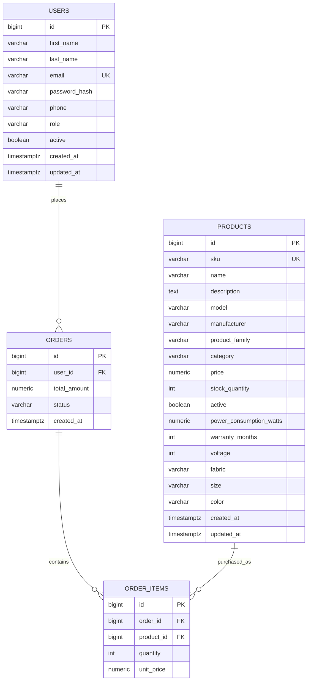

# Bloommerce — Entity Relationship Diagram

This diagram represents the initial PostgreSQL schema
for the Bloommerce e-commerce application.

## Design Notes

### Product Inheritance

Product uses JPA SINGLE_TABLE inheritance.

Both ElectronicsProduct and ClothingProduct are stored in the PRODUCTS table. The product_family discriminator identifies the appropriate Java subclass.

Subclass-specific fields are nullable when they do not apply to a particular product family.

### Relationship Constraints

- An Order belongs to one User.
- An Order contains one or more OrderItems.
- Each OrderItem references one Product.
- A Product may appear in multiple historical OrderItems.
- The combination of order_id and product_id must be unique.

### Additional Database Constraints

- User email and product SKU must be unique.
- Product price and stock quantity cannot be negative.
- Order item quantity must be greater than zero.
- Order totals and unit prices cannot be negative.
- Mandatory relationships use non-null foreign keys.

### Transactional Consistency

Checkout validates inventory and persists the order within a single transaction.

Stock deductions use atomic conditional updates to prevent overselling during concurrent requests.

### Scope

The diagram represents the initial MVP schema. Inventory reservations, payment information, shipping details, and return processes are intentionally excluded.
  